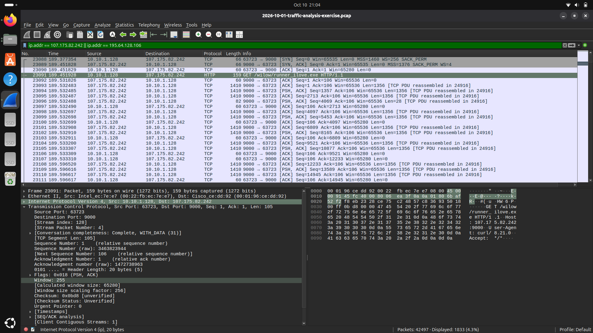
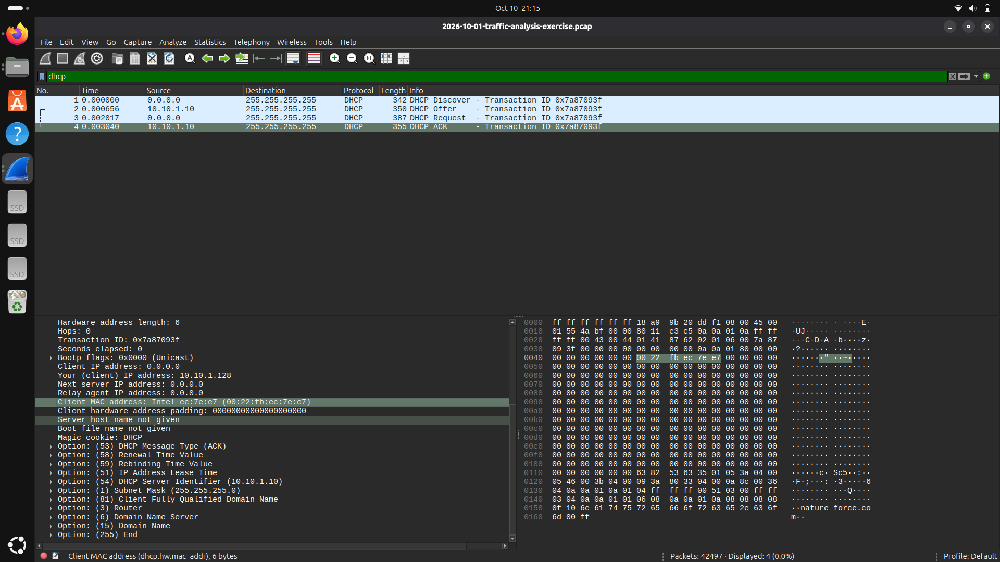
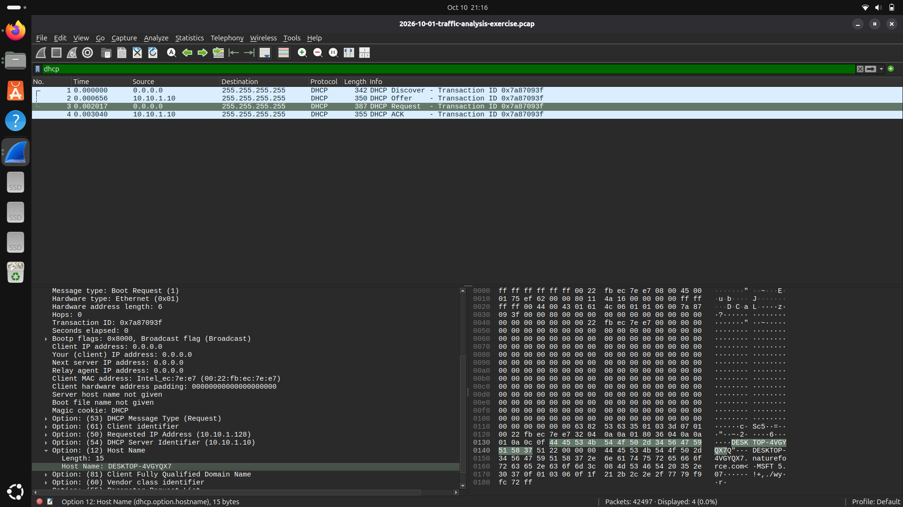
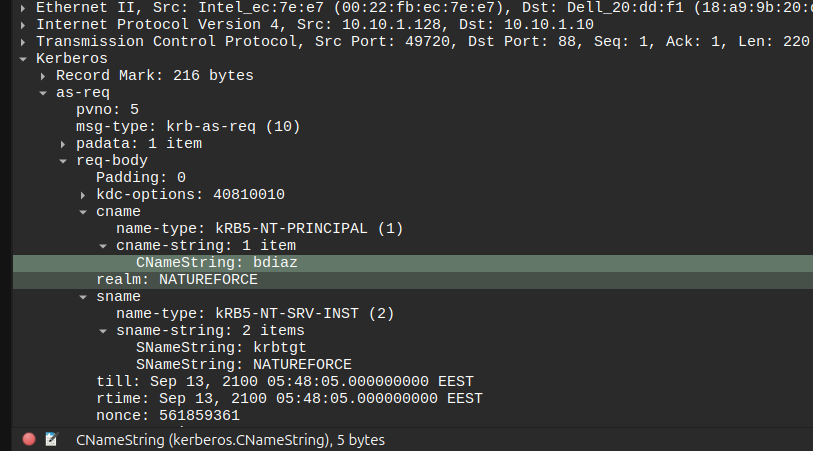
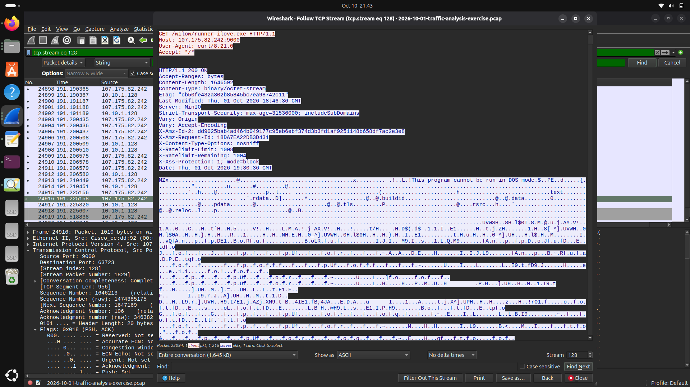
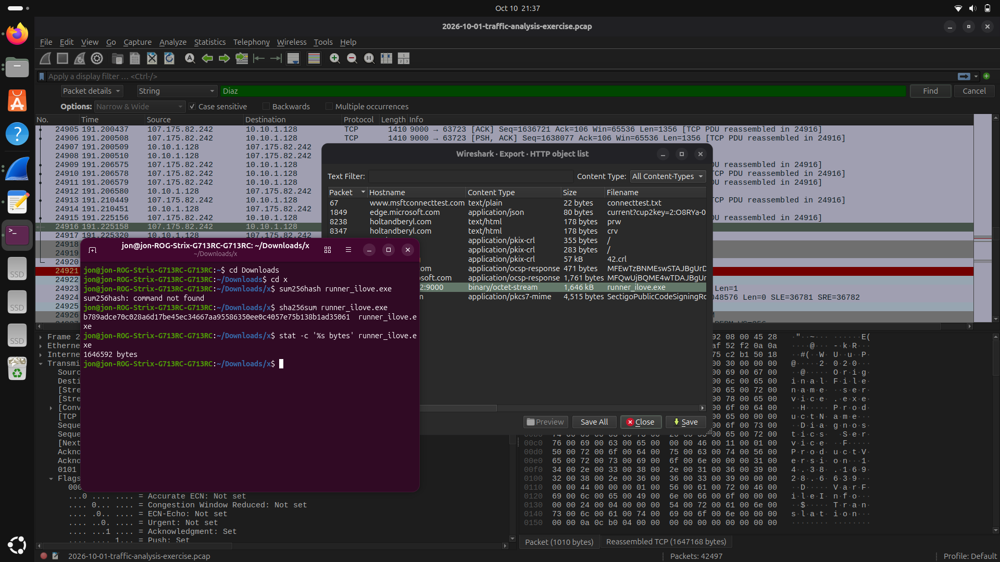

# Windows Malware Traffic Investigation — HTTP EXE Delivery

**Case study:** 2026-10-01 traffic analysis exercise  
**Source:** [Malware-Traffic-Analysis.net](https://www.malware-traffic-analysis.net/)  
**Capture:** `2026-10-01-traffic-analysis-exercise.pcap`  
**Tools:** Wireshark, Ubuntu Linux, `sha256sum`, `stat`  
**Type:** Educational network-forensics / SOC investigation

> This is an analysis of a published training PCAP, not a live corporate incident. The executable itself and the PCAP are **not** redistributed in this repository. All evidence shown comes from the provided investigation screenshots. The identified IPs are incident artifacts, not proof of present-day malicious activity.

## 1. Incident overview

The scenario begins with two SOC alerts:

- `107.175.82[.]242:9000` — a Windows executable transferred using an unusual TCP port.
- `195.64.128[.]106:443` — traffic flagged as `CNCmachineRMS RAT C2`.

The exercise asks for identification of the affected Windows client and the SHA-256 of the Windows executable delivered from the first endpoint. This report addresses those **five stated questions**; it does not independently validate the second C2 alert.

**Network context**

| Parameter | Provided value |
| --- | --- |
| LAN | `10.10.1.0/24` |
| Domain | `natureforce.com` |
| AD environment | `NATUREFORCE` |
| Domain controller / DHCP server observed | `10.10.1.10` / `WIN-LEKBU2OY51N` |
| Gateway | `10.10.1.1` |
| Broadcast | `10.10.1.255` |

## 2. Investigation results

| # | Incident-report question | Finding | Supporting figure |
| --- | --- | --- | --- |
| 1 | What is the IP address of the infected Windows client? | **`10.10.1.128`** | [Figure 1](#figure-1--http-request-from-the-windows-client) |
| 2 | What is the MAC address of the infected Windows client? | **`00:22:fb:ec:7e:e7`** | [Figure 2](#figure-2--dhcp-client-mac-address) |
| 3 | What is the host name of the infected Windows client? | **`DESKTOP-4VGYQX7`** | [Figure 3](#figure-3--hostname-in-dhcp-option-12) |
| 4 | What is the user account name from the infected Windows client? | **`bdiaz`** (`NATUREFORCE\bdiaz`) | [Figure 4](#figure-4--user-account-in-kerberos-as-req) |
| 5 | What is the SHA-256 hash of the Windows EXE sent from `107.175.82[.]242:9000`? | **`b789adce70c028a6d17be45ec34667aa95586350ee0c4057e75b138b1ad35061`** | [Figures 5–6](#figure-5--pe-evidence-in-the-http-response) |

## 3. Investigation methodology and evidence

### 3.1 Identify the Windows client (Question 1)

**Wireshark display filter:**

```wireshark
ip.addr == 107.175.82.242 && tcp.port == 9000
```

The client `10.10.1.128` sends an HTTP `GET` request to `107.175.82.242` on TCP port `9000` for `/wilow/runner_ilove.exe`. In the original PCAP, the visible request is **frame 23091**, using TCP stream **128**. The client source IP in this packet directly answers Question 1. A subsequent server response is investigated in Section 3.5.

**Figure 1 — HTTP request from the Windows client**



*Figure 1. The selected frame 23091 contains `GET /wilow/runner_ilove.exe HTTP/1.1`, with source `10.10.1.128` and destination `107.175.82.242`. The HTTP request is evidence of the client contacting the flagged download endpoint.*

### 3.2 Identify the MAC address (Question 2)

**Wireshark display filter:**

```wireshark
dhcp
```

The DHCP exchange consists of Discover, Offer, Request and ACK frames. In **frame 4 (DHCP ACK)**, the `Your (client) IP address` field is `10.10.1.128`, while `Client MAC address` is `00:22:fb:ec:7e:e7`. Reading these fields together ties the MAC address to the same client IP identified in Figure 1. The server sends the ACK from `10.10.1.10`.

**Figure 2 — DHCP client MAC address**



*Figure 2. DHCP ACK details show `Your (client) IP address: 10.10.1.128` and `Client MAC address: 00:22:fb:ec:7e:e7`, supporting Question 2.*

### 3.3 Identify the hostname (Question 3)

**Wireshark display filter:**

```wireshark
dhcp
```

The **DHCP Request (frame 3)** includes **Option 50: Requested IP Address = `10.10.1.128`** and **Option 12: Host Name = `DESKTOP-4VGYQX7`**. The requested IP associates the hostname with the investigated machine; the hostname is not inferred from the domain controller's name.

**Figure 3 — Hostname in DHCP Option 12**



*Figure 3. The expanded Option 12 field exposes `Host Name: DESKTOP-4VGYQX7`, while Option 50 associates this request with `10.10.1.128`. This directly answers Question 3.*

### 3.4 Identify the Windows user account (Question 4)

**Wireshark display filter:**

```wireshark
kerberos && ip.src == 10.10.1.128
```

Kerberos AS-REQ messages sent from the client to the domain controller on TCP/88 were inspected at:

`Kerberos → as-req → req-body → cname → cname-string → CNameString`

Some requests contain `desktop-4vgyqx7$`, which is the **Active Directory computer account**, not the human user's logon name. A separate AS-REQ contains **`CNameString: bdiaz`** with **`realm: NATUREFORCE`**. This supports reporting `bdiaz` as the observed domain user-account name, answering Question 4. The screenshot shows a request, **not** independent proof that logon succeeded or that this person executed the downloaded file.

**Figure 4 — User account in Kerberos AS-REQ**



*Figure 4. The `cname-string` field contains `bdiaz` and the `realm` field contains `NATUREFORCE`. Unlike the separate machine-account request ending in `$`, this is the observed user principal relevant to Question 4.*

### 3.5 Verify the transferred executable (Question 5, part A)

**Wireshark display filter:**

```wireshark
tcp.stream == 128
```

Using **Follow → TCP Stream** on the HTTP connection exposes a client request for `/wilow/runner_ilove.exe` and a server response with:

```http
HTTP/1.1 200 OK
Content-Length: 1646592
Content-Type: binary/octet-stream
Server: MinIO
```

The response body begins with the **`MZ`** DOS-header signature and contains `This program cannot be run in DOS mode` and a visible `PE` signature, consistent with a Windows Portable Executable (PE). This supports the nature of the transferred file; the string `MZ` alone would not establish maliciousness. The response advertises **1,646,592 bytes**.

**Figure 5 — PE evidence in the HTTP response**



*Figure 5. The same TCP stream displays both the executable request and the binary HTTP response. The visible `MZ` header and DOS-mode message corroborate that the delivered object is a Windows PE executable.*

### 3.6 Export, hash and size-check the HTTP object (Question 5, part B)

In Wireshark, **File → Export Objects → HTTP** was used to select the HTTP object associated with `107.175.82.242:9000`, named `runner_ilove.exe`. The object was saved **only for offline examination**; it was not executed.

On Ubuntu, the following commands were used:

```bash
sha256sum runner_ilove.exe
stat -c '%s bytes' runner_ilove.exe
```

Observed results:

```text
b789adce70c028a6d17be45ec34667aa95586350ee0c4057e75b138b1ad35061  runner_ilove.exe
1646592 bytes
```

The local byte count **exactly matches** the `Content-Length` in Figure 5, providing a consistency check for the exported HTTP object. The calculated SHA-256 is the answer to Question 5. A matching size does not by itself cryptographically prove completeness, but it supports the export alongside the HTTP reconstruction.

**Figure 6 — HTTP export, SHA-256 and file-size verification**



*Figure 6. Wireshark lists the selected binary object from `107.175.82.242:9000`; the Ubuntu terminal displays the SHA-256 digest and the exact 1,646,592-byte file size.*

## 4. Indicators and artifacts

| Type | Value | Interpretation |
| --- | --- | --- |
| Investigated client IP | `10.10.1.128` | Internal Windows host |
| Client MAC | `00:22:fb:ec:7e:e7` | DHCP client hardware address |
| Client hostname | `DESKTOP-4VGYQX7` | DHCP Option 12 |
| User-account name | `NATUREFORCE\bdiaz` | Observed Kerberos AS-REQ principal |
| Download endpoint | `107.175.82[.]242:9000` | Alerted external endpoint |
| Object path | `/wilow/runner_ilove.exe` | HTTP GET path |
| File type | Windows PE executable | Visible PE header indicators |
| HTTP body size | `1646592` bytes | HTTP header and local size check |
| SHA-256 | `b789adce70c028a6d17be45ec34667aa95586350ee0c4057e75b138b1ad35061` | Hash of exported object |
| Additional alerted endpoint | `195.64.128[.]106:443` | Listed in the scenario; not analyzed in this report |

## 5. Conclusion and limitations

The training PCAP shows that Windows client **`10.10.1.128`** requested and received a Windows executable from the alerted server at **`107.175.82.242:9000`**. DHCP links the client to MAC **`00:22:fb:ec:7e:e7`** and hostname **`DESKTOP-4VGYQX7`**. Kerberos requests include domain user account **`bdiaz`**. Wireshark HTTP object export and Ubuntu hashing yielded the SHA-256 reported above.

This is **network-level evidence**, not host-based confirmation that the executable ran, that its content is malicious, or that the user `bdiaz` initiated it. The scenario's second alert concerning `195.64.128[.]106:443` is background context and remains outside the five-question investigation scope.

## 6. Reproduction and evidence handling

The report can be independently reproduced by opening the exercise PCAP in Wireshark and applying the filters in Sections 3.1–3.6. The `evidence/` folder contains the unmodified screenshots supplied during the investigation, numbered to correspond to the six figures in this README.

**Safe handling:** Treat exported EXE files as untrusted. Do not execute them, do not upload them to this GitHub repository, and perform further dynamic analysis only in a controlled isolated environment. This repository intentionally contains **documentation and PNG evidence only**.

## References

- [Malware-Traffic-Analysis.net — Traffic Analysis Exercises](https://www.malware-traffic-analysis.net/) — educational exercise and PCAP provenance.
- [Wireshark User's Guide](https://www.wireshark.org/docs/wsug_html_chunked/) — display filters, Follow TCP Stream, and Export Objects functionality.
- [Microsoft — Kerberos authentication overview](https://learn.microsoft.com/en-us/windows-server/security/kerberos/kerberos-authentication-overview) — context for Kerberos authentication and account principals.
